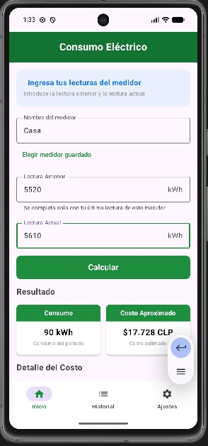
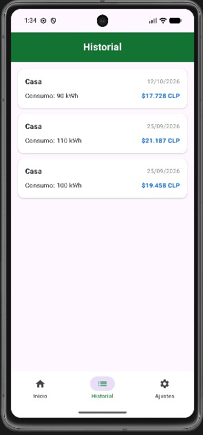
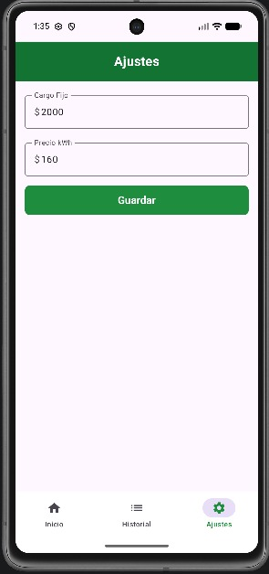

# Medidor Eléctrico

Aplicación Android que calcula el consumo y costo aproximado de electricidad a partir de las lecturas del medidor del hogar.

## Descripción del proyecto

La app permite al usuario ingresar la lectura anterior y la lectura actual de su medidor eléctrico, calcular el consumo en kWh y obtener una estimación del costo en pesos chilenos (CLP), incluyendo el desglose de cargo fijo, energía consumida e impuestos.

Nace como respuesta a un problema real: en Chile, los usuarios generalmente solo conocen su consumo eléctrico al recibir la boleta mensual, lo que dificulta planificar el gasto y tomar decisiones informadas sobre el uso de energía en el hogar.

## Exposición del problema

En Chile, la mayoría de las personas se entera de cuánto consumió de electricidad recién cuando llega la boleta del mes. Para ese momento ya no hay mucho que hacer: el gasto está hecho y es difícil saber en qué se fue. Además, la boleta junta varios cobros (energía, cargo fijo, impuestos) y no siempre es fácil entender de dónde sale el total.

Con esta app quise que el usuario pueda revisar su medidor cuando quiera, ver cuántos kWh ha consumido y cuánto costaría aproximadamente, sin esperar a fin de mes.

## Plataforma

Desarrollé la aplicación para **Android**, usando Android Studio con **Kotlin** y **Jetpack Compose (Material 3)** para la interfaz. Los datos se guardan en el teléfono con **SQLite**, a través de `SQLiteOpenHelper`. Para probarla usé el emulador de un Pixel 7.

## Interfaz de usuario e interfaz de administrador

La app tiene tres pantallas, a las que se llega desde una barra de navegación inferior.

**Interfaz de usuario**
- **Inicio:** acá ingreso el nombre del medidor y las lecturas, y la app calcula el consumo y el costo. También puedo elegir un medidor que ya guardé antes.
- **Historial:** muestra los cálculos guardados en tarjetas, del más nuevo al más antiguo.

**Interfaz de administrador**
- **Ajustes:** acá configuro el cargo fijo y el precio del kWh. En esta versión no hay un administrador separado, así que esta pantalla cumple ese papel: quien usa la app puede actualizar las tarifas cuando cambian en la boleta.

## Funcionalidad

**Cálculo del consumo y del costo.** El consumo es la lectura actual menos la anterior. A eso le aplico el precio del kWh para obtener la energía, y después sumo el cargo fijo y los impuestos (8,1 % sobre la energía más el cargo fijo) para llegar al total. Por ejemplo, de 8590 a 8650 son 60 kWh: la energía cuesta $9.600, los impuestos $939 y el total es **$12.539**.

**Medidores guardados.** Puedo elegir un medidor que ya usé y la app completa sola la lectura anterior con la última que guardé.

**Validaciones.** Para evitar errores, el nombre del medidor es obligatorio, la lectura actual no puede ser menor que la anterior y los campos de lectura solo aceptan números. Cuando el cálculo se guarda bien, aparece un mensaje de confirmación.

**Historial.** Cada cálculo queda guardado con el nombre del medidor, la fecha, el consumo, el costo total y la lectura actual.

**Ajustes de tarifa.** El cargo fijo y el precio del kWh se pueden cambiar, y los nuevos valores se usan desde el siguiente cálculo.

**Base de datos.** Los ajustes y el historial se guardan en dos tablas SQLite (`ajustes` e `historial`), por lo que no se pierden al cerrar la app.

## Diseño (wireframes)

Antes de programar, dibujé a mano un esquema de cada pantalla y después lo pasé a Figma. Esos wireframes fueron la base de la app. A continuación muestro cada wireframe junto a cómo quedó la pantalla en la app terminada, probada en el emulador.

### Inicio
Campos de lectura anterior, lectura actual y nombre del medidor, botón Calcular, el resultado (consumo y costo aproximado) y el detalle de la boleta (cargo fijo, energía consumida e impuestos).

<table>
<tr><th>Wireframe</th><th>App terminada</th></tr>
<tr>
<td></td>
<td></td>
</tr>
</table>

### Historial
Lista de tarjetas, una por cada cálculo guardado, con el nombre del medidor, la fecha, el consumo y el costo.

<table>
<tr><th>Wireframe</th><th>App terminada</th></tr>
<tr>
<td></td>
<td></td>
</tr>
</table>

### Ajustes
Dos campos, para el cargo fijo y el precio del kWh.

<table>
<tr><th>Wireframe</th><th>App terminada</th></tr>
<tr>
<td></td>
<td></td>
</tr>
</table>

Las tres pantallas comparten la barra de navegación inferior (Inicio, Historial y Ajustes).

**Cambios respecto a los wireframes:** al programar la app agregué algunas cosas que no estaban en el dibujo. En Inicio, un listado para elegir un medidor ya guardado (que completa solo la lectura anterior), el texto de ayuda y los mensajes de validación. En Ajustes, un botón Guardar. También cambié el diseño de los resultados a tarjetas y agregué colores verdes a la barra superior. La estructura general y la barra de navegación se mantuvieron.

## Registro de cambios (Changelog)

### Módulo 1
- Propuesta inicial del proyecto: descripción de la idea, sin código todavía.

### Módulo 2
- Instalación y configuración de Android Studio y el emulador (Pixel 7).
- Pantalla principal con lectura anterior, lectura actual, y cálculo de consumo y costo aproximado.

### Módulo 3
- Wireframes de las 3 pantallas (Inicio, Ajustes, Historial), dibujados a mano y digitalizados en Figma.
- Implementación de las pantallas de Ajustes e Historial.
- Navegación entre pantallas con barra inferior e íconos.
- Persistencia de datos (tarifas e historial) usando `SharedPreferences`, para que no se pierdan al cerrar la app.
- Campo para el nombre del medidor.

### Módulo 4
- Los campos de lectura y nombre del medidor ahora parten vacíos al abrir la app, en vez de tener datos de ejemplo.
- Se puede elegir un medidor ya usado desde una lista; la app autocompleta la "Lectura Anterior" con la última lectura guardada de ese medidor.
- Validación: no se puede calcular sin ingresar el nombre del medidor.
- Validación: la lectura actual no puede ser menor que la anterior, con un mensaje breve en pantalla si pasa.
- Mensaje de confirmación al guardar un cálculo exitosamente.
- Los campos de lectura ahora solo aceptan números (se filtran letras y otros caracteres).
- Se agrega esta sección de changelog al README, para llevar un registro claro de los avances de cada módulo.

### Módulo 5 (actual)
- Migré el guardado de datos de `SharedPreferences` a una base de datos real. Intenté primero con **Room**, pero tuve varios problemas de compatibilidad con el plugin `kapt` en mi versión de Android Studio y no logré dejarlo funcionando.
- Terminé implementando **SQLite directo** con `SQLiteOpenHelper` (viene incluido en Android, sin necesitar plugins adicionales), creando las tablas `ajustes` e `historial` con SQL y usando `ContentValues` y `Cursor` para guardar y leer los datos.
- Con esto, tanto los ajustes de tarifa como el historial de cálculos ahora se guardan en una base de datos SQL local en vez de `SharedPreferences`.

### Próximos pasos (planeado)
Para una versión futura pienso incorporar:
- Subir la boleta en PDF de la compañía eléctrica para sacar los datos iniciales (sector tarifario, ubicación, número de medidor).
- Cargar las tarifas de las distintas distribuidoras del país, que tienen un formato estándar, para calcular transporte, energía, potencia y cargos por servicios públicos.
- Escanear el consumo del medidor con la cámara.
- Georreferenciar el medidor.
- Mostrar gráficos de consumo.
- Una pasarela de pago para pagar la boleta, que solo sería posible si hay un acuerdo comercial con la compañía.
- Evaluar volver a intentar Room si cambio de versión de Android Studio.

## Herramientas utilizadas

Trabajé todo el proyecto en Android Studio, usando Kotlin y Jetpack Compose para la interfaz. Para las pruebas usé el emulador de Android configurado con un Pixel 7.

Un desafío que tuve que resolver la primera semana fue que mi computador (en ese momento con 8 GB de RAM) no siempre daba abasto para correr Android Studio y el emulador al mismo tiempo, lo que hacía que el emulador se colgara o tardara mucho en cargar. Tuve que investigar cómo liberar memoria y reiniciar procesos que quedaban corriendo en segundo plano para poder seguir probando la app con normalidad. Ya actualicé mi equipo a 16 GB de RAM, así que ese problema ya no lo he tenido.

En el módulo 3 el desafío fue distinto: al agregar los íconos de la barra de navegación tuve un error de compilación porque me faltaba agregar una dependencia (`material-icons-extended`) en el `build.gradle.kts`, y aprendí a diferenciar entre el archivo de configuración del proyecto completo y el del módulo `app`, que son fáciles de confundir.

En el módulo 4 el desafío principal fue pensar cómo simular el concepto de "cerrar el mes" sin tener que armar algo muy complejo: terminé usando el mismo historial que ya tenía guardado para buscar la última lectura de cada medidor, en vez de crear una tabla o lógica aparte solo para eso.

En el módulo 5 el desafío fue justamente el guardado de datos: después de varios intentos fallidos configurando Room (problemas con el plugin `kapt` y la versión de Android Studio), opté por implementar SQLite directo con `SQLiteOpenHelper`, que viene incluido en Android y no requiere plugins adicionales. Aprendí a definir tablas con sentencias `CREATE TABLE`, y a usar `ContentValues` y `Cursor` para insertar y leer datos.

## Cómo ejecutar el proyecto
1. Clonar este repositorio.
2. Abrir el proyecto en Android Studio.
3. Sincronizar Gradle.
4. Ejecutar en un emulador o dispositivo físico con el botón ▶️ Run.

## Referencias
- Ministerio de Energía de Chile. (2023). *Estudio revela que el 73% del consumo energético de los hogares se destina a calefacción, climatización y agua caliente.* https://energia.gob.cl/noticias/nacional/estudio-revela-que-el-73-del-consumo-energetico-de-los-hogares-se-destina-calefaccionclimatizacion-y-agua-caliente
- Android Developers. (2019). *Enfoque de prioridad de Kotlin en Android.* Google. https://developer.android.com/kotlin/first?hl=es-419
